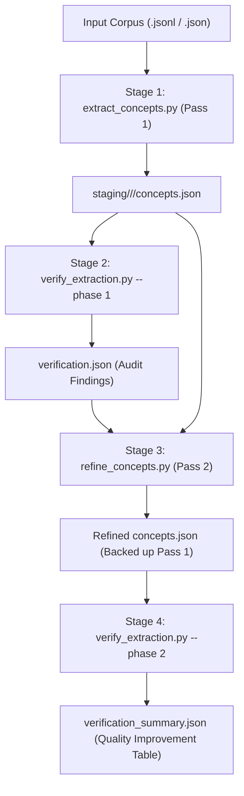

# Concept Knowledge Graph & Wiki Pipeline

This repository provides an end-to-end, high-throughput pipeline to convert unstructured long-document corpora into a dense, interconnected **Concept Knowledge Graph** and **Markdown Wiki**.

---

## 1. Core Architectural Philosophy

1. **Pure XML Formatting (No JSON Generation)**:
   - Prompts and outputs across all stages use strict XML tags (`<concept>`, `<verification>`, `<new_concept>`, `<update_concept>`).
   - Completely eliminates JSON quote escaping breakage (especially prevalent in code, math, formulas, and multi-line text).
   - Reduces token overhead by 20–30% compared to JSON.
2. **Strict Concept Schema: Only `title`, `aliases`, and `description`**:
   - Concepts consist strictly of:
     - **`title`**: 1–6 words, Title Case, canonical name (singular).
     - **`aliases`**: Explicit acronyms or alternate names found in the text.
     - **`description`**: A comprehensive, fact-dense paragraph (100–250+ words).
   - Outbound relations and entity lists are excluded during extraction and refinement. This focuses 100% of LLM output capacity on squeezing the chunk factually dry so the original chunk can be discarded without loss.
3. **Sandboxed Reasoning (`<think>...</think>`) & Speed Optimization**:
   - Models like Qwen3.8-27B or DeepSeek-R1 reason inside `<think>...</think>` blocks, which are automatically stripped before parsing.
   - **Instruct / Non-Thinking Mode (`--disable_thinking`)**: Turns off thinking via `"chat_template_kwargs": {"enable_thinking": False}` with tuned sampling parameters, reducing extraction runtime from **4 hours down to 12 minutes (~20x speedup)**.
4. **Strict Two-Tier Parameter Resolution (Zero Hardcoded Python Defaults)**:
   - Parameters are resolved strictly in order: **CLI Flags > `config.json`**.
   - If a required parameter is missing from both, the script immediately raises an informative error.

---

## 2. Pipeline Stages



---

### Stage 1: Concept Extraction (`extract_concepts.py`)

Extracts solid, fact-dense concepts from overlapping token chunks.

#### XML Output Format:
```xml
<think>
[Optional sandboxed analysis or concept boundary planning]
</think>
<concept>
<title>Left-handedness</title>
<aliases>Left Handedness; Sinistrality</aliases>
<description>Left-handedness is a handedness trait characterized by preferential use of the left hand for manual tasks, occurring in approximately 10.6% of the general human population. Twin studies demonstrate a cross-dominance rate of 19% to 21% among monozygotic and dizygotic pairs...</description>
</concept>
```

#### Truncation Recovery via Continuation:
If a chunk hits the token ceiling (`finish_reason == "length"`), the extractor salvages all completed `<concept>` blocks, detects the cut-off title, and issues an automatic continuation request to complete the rest of the chunk.

---

### Stage 2: Audit Verification (`verify_extraction.py --phase 1`)

Audits the raw extracted concepts against the original source chunk to evaluate coverage and find omissions.

#### XML Output Format:
```xml
<think>
[Auditor comparison between source chunk and extracted concepts]
</think>
<verification>
<coverage_score>0.92</coverage_score>
<is_sufficient>true</is_sufficient>
<missing_concepts>
- Monozygotic Twins
</missing_concepts>
<missing_facts>
- Twin cross-dominance rate of 19% in specific cohorts
</missing_facts>
<hallucinations>
- None
</hallucinations>
<critique>Extraction retains the core handedness prevalence metrics but omits detailed twin breakdown.</critique>
</verification>
```

The output is saved as `staging/<doc>/<chunk>/verification.json` for consumption by the refinement pass.

---

### Stage 3: Second-Pass Refinement (`refine_concepts.py`)

Consumes the raw chunk, Pass 1 concepts, and audit verification feedback to patch omissions.
- Creates brand-new concepts via `<new_concept>`.
- Patches existing concepts with newly discovered facts via `<update_concept>`.
- Backs up original Pass 1 output to `concepts_pass1_backup.json`.

#### XML Patch Format:
```xml
<think>
[Refinement planning addressing audit feedback]
</think>
<new_concept>
<title>Monozygotic Twins</title>
<aliases>Identical Twins</aliases>
<description>Monozygotic twins develop from a single fertilized ovum that splits into two embryos...</description>
</new_concept>

<update_concept>
<title>Left-handedness</title>
<additional_aliases>Sinistrality</additional_aliases>
<additional_description>Cross-dominance was recorded at 19% among twin cohorts under controlled phenotypic evaluation.</additional_description>
</update_concept>
```

---

### Stage 4: Second-Pass Verification (`verify_extraction.py --phase 2`)

Re-audits the refined chunks and writes `verification_summary.json`, displaying an automated before/after quality improvement report.

---

## 3. Configuration & Server Setup

Execution parameters are defined in `config.json` at the repository root:

```json
{
  "servers": {
    "http://cn13-dgx:8000/v1": 64,
    "http://cn43-l40:8005/v1": 32,
    "http://cn35-a40:8002/v1": 24,
    "http://cn26-a40:8000/v1": 20,
    "http://cn26-a40:8001/v1": 20
  },
  "model_name": "Qwen/Qwen3.8-27B",
  "concurrency_per_server": 32,
  "max_tokens": 16000,
  "request_timeout": 2400.0,
  "enable_thinking": false
}
```

### Parameter Reference:

| Parameter | CLI Flag | `config.json` Key | Description |
| :--- | :--- | :--- | :--- |
| **Wiki Path** | `--wiki_path` (or `--wiki_dir`) | — | Output folder path (e.g. `/path/to/wiki/biology`). |
| **Input Path** | `--input_path` | — | Input corpus file (`.jsonl` or `.json`). |
| **Model** | `--model <name>` | `"model_name"` | Model name served on vLLM. |
| **Servers** | `--servers <urls...>` | `"servers"` | Server list or dictionary of `URL: concurrency`. |
| **Concurrency** | `--concurrency_per_server <N>` | `"concurrency_per_server"` | Fallback in-flight requests per server. |
| **Max Tokens** | `--max_tokens <N>` | `"max_tokens"` | Max output tokens per request. |
| **Timeout** | `--request_timeout <seconds>` | `"request_timeout"` | Per-attempt HTTP timeout. |
| **Disable Thinking** | `--disable_thinking` | `"enable_thinking": false` | Disables thinking mode for massive speedup. |
| **Enable Thinking** | `--enable_thinking` | `"enable_thinking": true` | Allows full `<think>...</think>` sandboxed reasoning. |
| **Resume** | `--resume` | — | Clears incomplete states and resumes from checkpoint. |

---

## 4. End-to-End Execution Guide

### Step 1: Run Concept Extraction (Pass 1)
```bash
python3 extract_concepts.py \
  --input_path "/path/to/data/biology.jsonl" \
  --wiki_path "/path/to/wiki/biology" \
  --disable_thinking
```

### Step 2: Audit Pass 1 (Verification Phase 1)
```bash
python3 verify_extraction.py \
  --wiki_path "/path/to/wiki/biology" \
  --phase 1 \
  --disable_thinking
```

### Step 3: Refine Concepts (Pass 2)
```bash
python3 refine_concepts.py \
  --wiki_path "/path/to/wiki/biology" \
  --disable_thinking
```

### Step 4: Re-Audit & Measure Improvement (Verification Phase 2)
```bash
python3 verify_extraction.py \
  --wiki_path "/path/to/wiki/biology" \
  --phase 2 \
  --disable_thinking
```

---

## 5. Resuming Interrupted Runs

If any stage is stopped or interrupted, append `--resume` to continue immediately without repeating already-completed items:

```bash
python3 extract_concepts.py --wiki_path "/path/to/wiki/biology" --input_path "/path/to/data/biology.jsonl" --resume
python3 verify_extraction.py --wiki_path "/path/to/wiki/biology" --phase 1 --resume
python3 refine_concepts.py --wiki_path "/path/to/wiki/biology" --resume
python3 verify_extraction.py --wiki_path "/path/to/wiki/biology" --phase 2 --resume
```
